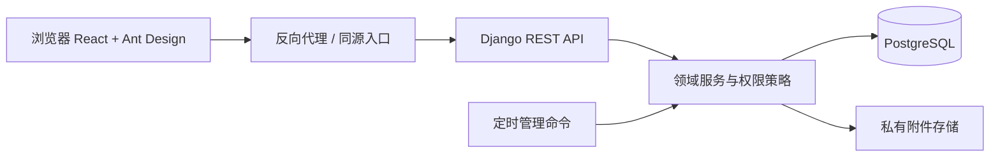

# 整体架构设计

状态（2026-10-29）：模块化单体提供 Docker Compose 部署配置；当前代码与迁移是技术事实来源，用户可见规则以[业务功能说明](../业务功能说明.md)为准；所有已实现接口以[OpenAPI 契约](openapi.yaml)为准。

## 1. 架构选择

采用**模块化单体**：一个 React 前端、一个 Django REST Framework 后端、一个 PostgreSQL 数据库和一个私有附件存储目录。适合小团队首版的部署、备份和问题定位。前端与后端可由同一反向代理提供同源访问。

| 层 | 职责 | 约束 |
| --- | --- | --- |
| React + TypeScript + Vite | 页面、交互、客户端表单提示 | 不持有业务权限真值；不直接拼接数据库字段 |
| Ant Design | 组件、交互模式、主题 token、中文本地化 | 以官方组件与锁定版本文档为准 |
| Django + DRF | 认证、API、序列化、业务服务、权限策略 | 视图保持薄；写入走服务层 |
| PostgreSQL | 事务、约束、并发与查询 | 迁移管理；时间以 UTC 存储 |
| 私有文件存储 | 附件和文档文件 | 通过鉴权 API 下载；可先用本地目录，接口可替换对象存储 |
| 定时任务 | 到期/逾期通知、清理临时文件 | 生产使用 Docker Compose scheduler 容器每日执行管理命令；必须幂等 |

已验证 Python 3.14.7、Django 5.2.18、DRF 3.18.3、PostgreSQL 17.11；前端精确版本以 package-lock.json 为准。Python 依赖锁定于 requirements.lock。开发数据库为本机专用 PostgreSQL 实例；生产部署参数从权限受限的环境变量文件读取；部署使用 Docker Compose 的 PostgreSQL、Django/Gunicorn、Nginx 和 remind 调度容器，附件及数据库各使用持久卷。镜像基础层从 ECR Public 获取，版本依赖锁定；可迁移包导出镜像、数据库、附件、Compose、部署配置与 TLS。

## 2. 模块边界

逻辑后端模块：`accounts`（用户、组、认证）、`projects`（项目、成员）、`work_items`（通用工作项）、`requirements`、`tasks`、`bugs`、`iterations`、`documents`、`notifications`、`reports`、`settings`、`audit`、`attachments`。实际代码集中在 backend/core：models.py 与迁移定义数据，policies.py 集中授权，services.py 实现事务业务，workflow.py 定义预设状态，serializers.py/schema.py 定义输出和输入契约，api.py 负责协议适配；按领域函数划分职责，共享工作项模型。

各领域代码目前集中在 `backend/core`，以 `models.py`、`services.py`、`policies.py`、`serializers.py`、`schema.py`、`api.py` 和 `querysets.py` 分担模型、事务服务、授权、契约、路由适配和读取优化；`sessions.py`负责认证会话期限，`links.py`负责可读链接生成。前端主要由 `frontend/src/main.tsx`、`ui.tsx`、`api.ts`、`work-detail.tsx`、`rich-editor.tsx` 与 `file-preview.tsx` 构成；主要列表/路由集中在 main.tsx，工作项详情和富文本/文件预览已拆分为独立组件。核心写入由服务层负责，不使用隐式信号实现状态流转、成员移交或审计。

## 3. 核心业务链

1. 登录建立服务端会话；同源请求携带会话 Cookie 和 CSRF 防护。接口统一检查用户启用状态及首次改密状态。
2. API 校验输入后调用权限策略：全局权限 → 项目可见范围 → 项目角色 → 对象级权限 → 项目/迭代状态。
3. 写服务在事务内重新读取并校验关键对象，执行写入及审计；对并发编辑用 `version` 比对，不静默覆盖。
4. 事务提交后生成非关键通知；通知创建失败不得伪装成业务写入失败，需记录可重试事件。到期提醒由幂等定时任务生成。
5. 列表、详情、附件、报表和导出均使用同一项目范围查询策略；无权对象统一返回 404，避免通过编号探测项目数据。

## 4. 状态与关联

工作项采用共同的身份、权限、评论、附件、审计能力；需求/任务/缺陷各自有明细字段和独立状态配置。工作流保存在默认模板及项目 JSON 中，状态码稳定，完成语义来自状态类别；已引用状态不可删除或改类别。新项目复制系统模板。流转与重新激活在服务事务内校验路径、版本、权限和至少一位处理人，并一并保存状态、处理人、评论、审计和通知事件。当前流转不要求原因、通知成员或未完成关联任务确认。前端显示允许操作，但服务端始终重复校验。

需求到任务为一对多；任务可没有需求。缺陷可选关联同项目的需求和任务。一个工作项最多属于一个迭代。删除关联目标时不级联删除工作项；历史引用保留，普通界面提示目标不可用。

## 5. 一致性、性能与运行

- 项目关闭、成员移除、用户停用与工作项写入要在事务中检查当前状态。最后一名管理员、同项目关联、唯一编号等约束需有数据库约束或事务级保护。
- 批量更新遵循业务说明“逐项校验、逐项报告”，每项独立事务；请求可部分成功。不得在 UI 中报告“全部成功”掩盖失败项。
- 查询使用分页和必要索引；列表默认 20 条，服务端限制最大页大小。报表按权限过滤后聚合，避免把全量记录送到前端计算。
- 统一结构化日志与请求 ID。日志不记录密码、令牌、附件正文。数据库与附件需要同一时间点的可恢复备份；上线前演练恢复。
- 首版不做实时协作；页面保存采用版本号冲突提示。通知可轮询或页面刷新，暂不要求 WebSocket。

## 6. 当前运行边界与待部署事项

本地实现包含交互式管理员初始化、一次性临时密码、可配置附件限制、事务通知事件重试和开发模式模拟数据命令。部署者需根据目标环境确定域名或内网访问方式、HTTPS、附件容量上限及备份保留期。产品未要求的实时协作、微服务、通用流程引擎、消息队列和独立搜索服务未引入。上述生产参数记录到[决策清单](decisions.md)，不得将未确认的生产配置写成已部署事实。

可视化编辑使用锁定版本的 Vditor 即时渲染（IR）编辑器，客户端 Markdown 作为现有正文格式；富文本图片及普通附件通过同源 multipart 由服务层统一事务保存。src/rich-editor.tsx 管理 Markdown 即时编辑、文字颜色、内存图片预览和安全阅读；阅读链路为 ReactMarkdown/GFM → rehype-raw → rehype-sanitize，默认安全白名单仅扩展 span 的十六进制 color 样式，图片继续限制到鉴权附件；服务层 write_record 统一处理父记录、附件、图片引用及回滚清理。前端视图偏好按当前用户 ID 存储，不改变服务端业务状态。无新增进程或数据库迁移。

编辑器必要运行时由 frontend/scripts/sync-editor.mjs 在 dev/build 前从锁定包同步为同源静态资源，生成文件不提交。表单左右栏独立，操作区固定于视口底部。

工作项详情拆分至 src/work-detail.tsx，展示与权限回调分开；左右栏在视口内各自滚动，编辑/查看共用布局尺度和底部操作。服务层 update_item 的 transition 分支统一保存状态、负责人和可选评论，复用 comment_write 和项目权限，不从前端串联多个写请求。

UI-15～17：处理人集合由服务层统一管理；旧 assignee 为兼容主处理人，策略、待办、报表与通知读取全部处理人。评论/流转图片复用 write_record 原子上传，失败清理磁盘；评论状态快照在创建事务中写入。新增 0004 迁移，需 migrate 后重启服务。

## 浏览器本地文档预览（D-03/UI-27）

文档文件服务core/document_files.py只做10MB大小/扩展名/基础签名和ZIP容器校验、原件保存及审计；Office容器限制1万条目、解压后200MB。项目行锁事务内再次校验可写，失败清理原件。后端无LibreOffice、转换子进程、临时转换目录或PDF生成逻辑。既有preview_file字段保留兼容但不再读写，无新增迁移。

前端file-preview.tsx使用React.lazy加载锁定的@file-viewer/react 3.2.2，统一将鉴权接口取得的ArrayBuffer及原文件名交给组件。按需加载配置清单对应的独立渲染器；@file-viewer/vite-plugin在dev/build复制19组运行时资产到/file-viewer/。无需外网CDN或Office服务，不增加转换后端。FilePreview生命周期随路由销毁，取消未完成的fetch，并用错误边界避免预览模块加载失败破坏应用。

导入扩展名由锁定版本项目确认的格式清单生成，写入前后端document-formats清单（21项）。保留10MB及ZIP一万条目/200MB解压体积限制；仅存原件和原有Document字段，无新迁移。生成命令npm run sync:document-formats。开发与验收服务使用不同Vite cacheDir。

采用组件内置只读渲染，不执行Office宏或上传的程序；组件可预览代码文件，但不将其作为应用脚本加载。上线部署必须包含完整/file-viewer/资源。PPT公开引擎等第三方运行时有各自许可与NOTICE，保留上游资产和PPT水印。

### UI-38：预览格式与资源裁剪（已实现）

标准@file-viewer/react 3.2.2搭配word、spreadsheet、presentation、pdf、mindmap、image、text独立渲染器；Vite formats使用frontend/document-preview-formats.json的21项清单，不加载Full或preset。前后端白名单及完整清单由sync:document-formats同步。只发布Office/PDF所需资产，保留LICENSE/第三方NOTICE及旧PPT水印；predev/prebuild清除旧生成资源，保留Vditor。移除格式不再允许新导入，历史原件和下载不删除。无接口路径、表结构或后端转换变化。

UI-45：附件预览使用独立前端attachment_preview查询路由，读取既有鉴权/api/v1/attachments/{id}原件接口；文件名/类型提示来自链接元数据，不用作授权。需求/任务/缺陷、项目文档附件、富文本附件链接复用同一页面。所有数据读取仍由服务端项目与父记录权限检查；不新增公开文件目录、转换、API或数据字段。

UI-46：目录复用模块化单体Document模型；document_parent/document_listing/document_write及import_document负责父目录校验、范围、排序、事务和删除保护，API不复制规则。项目行锁串行化同项目目录创建/上传/删除，避免删除目录后继续写入；权限复用现有access/role/version策略。无外部网盘、对象服务或新依赖。

UI-47工作项前端只保留列表；默认分类筛选复用统一列表分页查询，category=none转换为NULL条件，原项目/权限范围不变。`/projects/{id}/board` 仍在兼容路由中，但不再作为前端页面入口。当前项目详情独立于前100个项目选项加载，异步上下文请求取消过时状态写入；后端权限仍为最终依据。无新服务、依赖或数据库结构。

### UI-51 项目字典与表单精简

字典仍在模块化单体服务层实现。默认模板/项目字典共用Priority物理表，以project及kind隔离；创建项目时事务复制模板。列表维护使用共享React组件，不引入独立配置服务。旧优先级接口仅作为默认priority模板兼容入口。

UI-52工作流配置由共享WorkflowManager表格组件维护默认模板或项目JSON；服务validate_workflow集中验证图与引用，WorkItem.status_category保存类别快照，统一供待办/提醒/统计使用。无需引入通用流程引擎。

### UI-54 语义配色与工作流菜单

UI-54配色为展示规则，单一清单backend/core/color-presets.json供Python与TypeScript读取，前端构建需包含该仓库文件；后端发布须保留core下JSON资源。迁移冻结当时清单，避免后续推荐规则变更影响历史迁移。

### DEV-01 开发数据工具与清理
core/demo_data.py仅用于管理命令的场景编排，所有业务写入调用services/document_files既有入口，不新增API或数据库字段；管理命令限制DEBUG及系统管理员。历史时钟仅在命令进程内生效。确认无LibreOffice运行依赖；删除原PDF.js/Office/SheetJS专用旧预览CSS、未引用TERMINAL常量及旧pdfjs忽略项，保留历史迁移、preview_file兼容字段与File Viewer资源/许可证。

DEV-01读取优化：工作项列表及迭代内逾期项通过core/querysets.py统一预加载关联人与类型详情，子任务完成数用相关子查询统计，避免逐行查询。既有权限筛选及响应字段保持不变；服务层写入仍使用即时读取，避免旧缓存影响审计。

### UI-58 菜单访问与页面上下文

菜单访问独立于原功能permissions和项目角色：menu-catalog.json单一菜单清单供React与Django使用，policies.check_menu_route集中校验显式配置组的接口入口，原services/policies仍负责真实业务操作及数据范围。旧null配置兼容，超级管理员兜底防锁定。项目上下文与系统最小标签上下文是只读组合接口，为页面菜单隐藏后继续提供合法表单选项，不引入新服务或流程引擎。前端GroupEditor/Workbench独立组件，菜单编辑通过既有用户组服务事务保存，无新增运行依赖。

登录项目恢复使用当前浏览器按账号隔离的最近项目偏好，不跨设备同步；项目仍经现有API授权。强制改密凭已认证且服务端标记must_change_password的会话执行，普通改密继续验证旧密码。

迭代读取性能优化：GET /projects/{id}/iterations及项目context中的iterations只返回迭代基础字段、owner_name、item_total、item_completed；不返回items_by_state、overdue_items、recent_changes。列表关联负责人一次预加载，工作项数量使用数据库条件聚合，排除软删除工作项，完成数按completed类别统计。GET /iterations/{id}继续提供完整统计、逾期项和最近记录，点击迭代时按需加载。权限及写入规则不变，无数据迁移。

## 用户组细粒度授权（UI-73）

菜单访问与功能操作分开存储。core/policies.py基于共用action-catalog.json提供有效功能列表和require_action，业务写入服务在项目数据范围与身份约束之外检查操作，API仅负责菜单入口、读取及正式下载鉴权。前端从auth/me读取有效功能键控制按钮，不作为最终授权。null旧组保留原操作策略；显式组默认拒绝未授予操作。超级管理员绕过用户组配置但关键账号保护仍在服务层执行。

## UI-74 会话边界与分享入口

Django Session保留同源Cookie与CSRF。登录信号写入会话开始/活动时间及闲置过期日期；SessionLifetimeMiddleware在认证中间件后逐请求检查闲置期限，活动续期通过独立POST完成，并同步续期服务端Session和Cookie。前端真实活动与后台请求分离，跨标签页以服务端共享会话为准。默认7天闲置、实际操作滚动续期，无固定绝对上限，旧会话升级时重新登录；无需数据库变更。

可读路径只作为私有资源定位，不存分享token，不授权匿名访问。工作项通过不可变项目编码、类型、序号解析到原UUID；文档/迭代沿用UUID。附件先鉴权读取元数据再加载原件，统一复用登录门禁。现有Nginx SPA回退已支持路径直达；新链接不需要新增公开目录或服务器端渲染。

## UI-75 运行日志模块

OperationLog保存成功操作的精简摘要，operation_logs.py集中定义动作/对象中文目录、写入与筛选；服务层audit同步追加日志，不替代用于业务历史的Audit快照。认证成功/主动退出及下载、导出在鉴权后记录，普通读取/预览/保活不记录。读API全局只读，仅管理员或显式菜单授权可访问。复用Django/PostgreSQL，不增加日志服务；0014新增表，部署必须先迁移再启动新代码。

UI-79工作项复制为前端新建预填，由work-item-copy.ts筛选可写字段并把描述内图片转换为待上传文件；服务端继续通过现有创建、附件、鉴权、事务及审计服务处理，无独立克隆端点。复制菜单使用新建权限，删除保留原权限；前端来源ID不构成授权。
